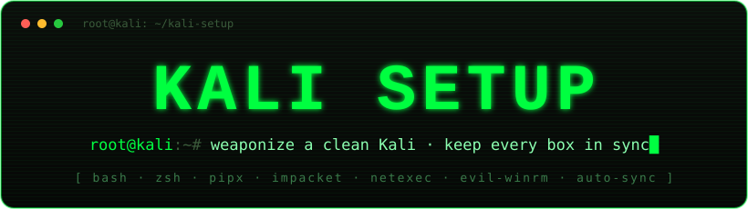

<div align="center">



**`// weaponize a clean Kali in one shot - keep every box in sync`**

[](#)
[](#)
[](#)
[](https://github.com/SysK69/kali-setup/actions/workflows/shellcheck.yml)

[🇬🇧 English](README.md) · **🇮🇹 Italiano**

</div>

---

## `> COS'È`

**kali-setup** è l'ambiente pentest come **codice**. Prende una Kali qualsiasi - nuova o incasinata - la porta a uno stato pulito e riproducibile, e la tiene aggiornata e **sincronizzata** su tutte le tue macchine.

Dichiari *cosa* vuoi una volta (script + manifesti); qualsiasi Kali diventa identica con un comando, e resta tale. Niente più PATH inquinato, impacket installato in tre modi, o binari in `/opt` scaricati mesi fa e mai aggiornati.

```console
root@kali:~# git clone https://github.com/SysK69/kali-setup
root@kali:~# cd kali-setup && bash setup.sh
root@kali:~# source ~/.zshrc
root@kali:~# update-all        # keep it fresh, forever
```

---

## `> COME FUNZIONA`

| | componente | fa cosa | quando |
|---|-----------|---------|--------|
| 🧹 | **`setup.sh`** | bonifica + configura una Kali (PATH, duplicati, impacket, deps, tool) | una volta, su macchina nuova |
| 🔄 | **`update-all`** | aggiorna *tutto* (sistema + tool + repo stesso) in un comando | settimanale / pre-engagement |
| 📦 | **`tools-sync`** | gestisce `/opt/pentest-tools` da manifesti dichiarativi | dentro update-all, o a mano |

**Principi:** dichiarativo · idempotente (rilanciabile in sicurezza) · single source of truth · multi-host · non distruttivo di default (niente rimosso senza conferma).

<details>
<summary>step di <code>setup.sh</code></summary>

```diff
+ [1] AUDIT      PATH, pipx, apt pentest tools
+ [2] FIX PATH   rimuove venv · ~/.local/bin davanti a /usr/bin
- [3] PURGE      crackmapexec · dirbuster · zenmap · wfuzz
+ [4] IMPACKET   pulisce script reali · reinstalla via pipx (fortra/impacket)
- [5] LEGACY     rimuove bloodhound pipx vecchio
+ [6] DEPS       libyaml-dev (fix gem psych)
+ [7] TOOLS      crea /opt/pentest-tools · installa dai manifesti · scaffold liste locali
+ [8] ARM        collega update-all a ~/.zshrc
```
Ogni step è guardato e salta ciò che è già a posto. Rilanciabile senza danni.
</details>

---

## `> update-all()`

Un comando, aggiorna tutto - e aggiorna sé stesso (step 1 = `git pull` di questo repo).

| # | target | cosa |
|---|--------|------|
| `1` | **kali-setup** | `git pull` del repo → auto-sync multi-host |
| `2` | **tools-sync** | `/opt/pentest-tools` dai manifesti |
| `3` | **apt** | full-upgrade · recupera i "kept-back" · `autoremove --purge` vecchi kernel · avviso reboot |
| `4` | **pipx** | tool Python isolati (impacket, netexec, bloodyad…) |
| `5` | **gem** | tool Ruby (evil-winrm) |
| `6` | **npm** | tool Node.js globali (da `npm.list` locale) |
| `7` | **pip --user** | librerie Python (da `pip.list` locale) |
| `8` | **/opt** | cloni git manuali in `/opt/pentest-tools/` |

> Fonte unica: [`shell/update-all.zsh`](shell/update-all.zsh), sorgiato da `.zshrc`. Le modifiche sono attive dalla **shell successiva** (o `source ~/.zshrc`). Stampa un **summary** per-step alla fine; esegui un sottoinsieme con `update-all --only apt,npm`, o fai l'anteprima dell'upgrade senza toccare nulla con `update-all --dry-run`. Lo step apt segnala anche una nuova release Kali quando disponibile. Vedi `update-all --help`.
>
> Per rimuovere: **`bash uninstall.sh`** scollega `update-all` da `~/.zshrc` e rimuove i symlink (`--purge` rimuove anche `/opt/pentest-tools` e la config locale). Non annulla le modifiche one-off di sistema (purge apt, impacket); `~/.zshrc` viene backuppato prima.

---

## `> TOOL MANAGER` - `/opt/pentest-tools/`

Dichiari *cosa* vuoi in un manifesto; `tools-sync.sh` lo ricostruisce identico su ogni Kali.

```bash
bin/tools-sync.sh                 # sync completo (git + release · condivisi + locali)
bin/tools-sync.sh --git-only      # solo repo git
bin/tools-sync.sh --release-only  # solo binari da GitHub Releases
bin/tools-sync.sh --import        # suggerisce tool trovati (non sposta nulla)
bin/tools-sync.sh --dedup         # copie sparse → keep/backup/trash/delete (chiede)
bin/tools-sync.sh --prune         # rimuove tool non dichiarati (opt-in, chiede)
```

| manifesto | formato | aggiornamento |
|-----------|---------|---------------|
| `tools/git.list` | `nome \| url_git` | `git clone` → poi `git pull` |
| `tools/release.list` | `nome \| owner/repo \| glob` | ultima release GitHub (solo se il tag cambia) |

- Tool **condivisi** in `tools/*.list` (committati) → si propagano su tutte le macchine a `update-all`.
- Voci **locali / per-macchina** in `~/.config/kali-setup/local.*.list` → fuori dal git.
- I binari release linux ottengono un symlink stabile `~/.local/bin/<nome>` → esegui `chisel`, non `chisel_1.12.0_linux_amd64`.
- `--dedup` trova vecchie copie sparse di un tool (per remote git o nome), mostra ogni versione accanto a quella canonica, e chiede (menu numerato) **keep / backup / trash / delete** - senza mai toccare `/opt/pentest-tools`.

---

## `> MULTI-HOST SYNC` - *strategia B*

```
   KALI #1 ──git push──▶ github.com/SysK69/kali-setup
                                  │
                   update-all → git pull
          ┌──────────────┬───────┴───────┐
          ▼              ▼                ▼
       KALI #2        KALI #3    ...   KALI #n
```

Modifichi config/manifesti su una macchina → push → ogni altra Kali li riceve al prossimo `update-all`. Config condivisa nel repo; eccezioni locali in `~/.config/kali-setup/`.

---

## `> REQUIREMENTS`

- **Shell: solo `zsh`** (default Kali). `setup.sh` scrive solo in `~/.zshrc`; `update-all.zsh` usa sintassi zsh/bash, non POSIX `sh`.
- Serve inoltre: `git`, `curl`, `python3` (sempre su Kali); `gh` opzionale (rate-limit GitHub alto / repo private).

> ⚠️ **Installazione per-utente.** Configura il *tuo* utente, non il sistema. `update-all` è agganciato al **tuo** `~/.zshrc`, i manifesti locali + `npm.list`/`pip.list` stanno in `~/.config/kali-setup/`, e `/opt/pentest-tools` è di proprietà dell'utente che lancia `setup.sh`. Tutto questo è legato al tuo account — **se ricrei o cambi utente lo perdi**. Se la macchina conta, fai backup di `~/.config/kali-setup/` (e del clone del repo). Per un'installazione system-wide (condivisa da tutti gli utenti) il wiring andrebbe in `/etc/zsh/zshrc` con `/opt` di gruppo — non supportato di default.

---

## `> TREE`

```
kali-setup/
├── setup.sh              # orchestratore: audit → fix → tools → arm
├── uninstall.sh          # scollega update-all + rimuove symlink (--purge rimuove anche i tool)
├── bin/tools-sync.sh     # gestore /opt/pentest-tools (git + release, dedup, prune, import)
├── tools/{git,release}.list   # manifesti CONDIVISI
├── shell/update-all.zsh  # update-all() · single source of truth
├── tests/tools-sync.bats # test unit bats (funzioni pure)
├── docs/index.html       # landing hacker (GitHub Pages, opzionale)
├── .github/workflows/shellcheck.yml   # CI lint + bats
├── README.md · README.it.md · CHANGELOG.md · CONTRIBUTING.md · LICENSE
└── assets/banner.svg
```

Locali, per-macchina (fuori dal repo): `~/.config/kali-setup/{local.git.list,local.release.list,npm.list,pip.list}`

---

## `> CONTRIBUTING` · `> LICENSE`

Vedi [CONTRIBUTING.md](CONTRIBUTING.md) - la CI gira `shellcheck` + `zsh -n` su ogni push/PR.
Licenza [MIT](LICENSE) © SysK69.

---

<div align="center">

`[ crafted for the terminal · no GUI required ]`

<sub>Realizzato con l'aiuto di Claude (Anthropic).</sub>

</div>
